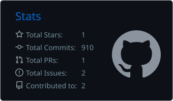
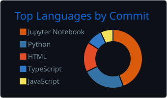

# Olá, eu sou o Saulo Henrique 👋

**Cientista de Dados & Engenheiro de Dados**

---

### 🧠 Sobre mim

Atuo de ponta a ponta no ciclo de dados e IA, da coleta ao deploy em produção, com foco em soluções **escaláveis, observáveis e autônomas**.

- 🤖 **IA & LLMs:** RAG, fine-tuning e agentes (LangChain/LangGraph, CrewAI, MCP)
- 🛠️ **Engenharia de Dados:** pipelines em larga escala com Python e Go, em AWS e GCP
- ⚙️ **MLOps & AIOps:** serving de modelos, CI/CD e observabilidade

### 🔭 Estudando

🏛️ Arquitetura de Software · 🌐 Sistemas Distribuídos · 🛡️ Segurança de IA · 💥 Engenharia do Caos & SRE

---
---

### 📊 GitHub Stats

  
  
    
  

---

### 🧰 Tecnologias

<h4>Linguagens</h4>

  
  
  
  
  
  
  
  

<h4>LLMs, Agentes & IA Generativa</h4>

  
  
  
  
  
  

<h4>Machine Learning & Ciência de Dados</h4>

  
  
  
  
  
  
  

<h4>Engenharia de Dados</h4>

  
  
  
  
  

<h4>Bancos de Dados</h4>

  
  
  
  
  
  
  
  

<h4>Cloud</h4>

  
  
  

<h4>MLOps, CI/CD & Plataforma</h4>

  
  
  
  
  
  
  
  
  
  
  

<h4>Observabilidade</h4>

  
  
  

<h4>Testes</h4>

  
  
  

